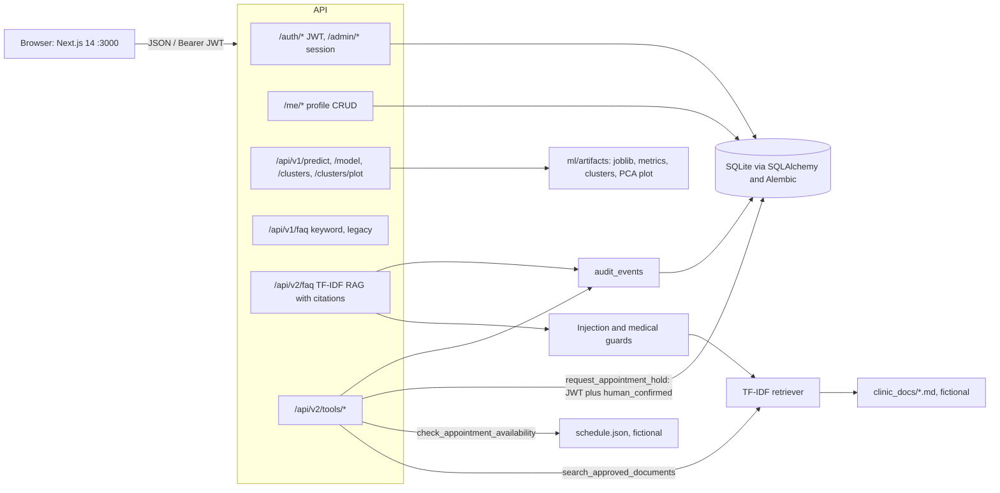

# HealthTech Profile Builder

[](https://www.python.org/)
[](https://fastapi.tiangolo.com/)
[](https://nextjs.org/)
[](https://scikit-learn.org/)
[](https://www.sqlite.org/)
[](https://docs.docker.com/compose/)
[](#-testing)

A full-stack internship project for building member wellness profiles with signed-in APIs, ownership-scoped data, educational machine learning, and a cited FAQ assistant.

**Stack:** FastAPI, SQLAlchemy, SQLite, Alembic, Next.js 14 (App Router), scikit-learn, JWT member auth, and revocable admin sessions.

> **Safety first.** This is a fictional educational demo. It uses synthetic and made-up clinic data only. It is **not** medical advice, diagnosis, triage, or treatment, and it is not a real patient system. Do not enter real health or personal data.

## Contents

- [Features](#-features)
- [Architecture](#-architecture)
- [Quick start](#-quick-start)
- [Week 1: Auth foundations](#-week-1-auth-foundations)
- [Week 2: Relational profiles](#-week-2-relational-profiles)
- [Week 3: Educational ML and FAQ](#-week-3-educational-ml-and-faq)
- [Week 4: RAG, tools, CI, and Docker](#-week-4-rag-tools-ci-and-docker)
- [API overview](#-api-overview)
- [Testing](#-testing)
- [Security notes](#-security-notes)
- [Safety disclaimer](#-safety-disclaimer)
- [Status and roadmap](#-status-and-roadmap)
- [Credits](#-credits)

## ✨ Features

| Area | What ships | Week |
|---|---|---|
| Member auth | Email signup and login, HS256 JWT access (15 min) and refresh (7 days), `/me` | 1 |
| Admin auth | Script-created admin only, revocable server-side session cookie, role separation | 1 |
| Profiles | Demographics, wellness preferences, emergency contacts (max 5), ownership-scoped CRUD | 2 |
| Authorization | IDOR attempts return 404, request bodies `extra="forbid"`, admin search is session-only | 2 |
| Audit | Profile writes and admin list access log field names or filter keys, never values or secrets | 2 |
| Migrations | Alembic `0001_week1_baseline`, `0002_week2_profiles`, then `0003_week4_holds` | 2-4 |
| Educational ML | Synthetic engagement dataset, Logistic Regression vs Random Forest picked by 5-fold CV, dummy baselines, K-Means clusters with a PCA plot | 3 |
| Keyword FAQ | Deterministic evidence-group matcher over an approved fictional corpus, with safe abstention | 3 |
| RAG FAQ | Local TF-IDF retrieval over fictional clinic docs, citations, medical and injection guards | 4 |
| Tools | Document search, fictional availability, confirmation-gated mock appointment hold | 4 |
| UI | Next.js pages for signup, login, profile, ML, FAQ, and (Week 4) the assistant | 1-4 |
| Quality | pytest suites, jsdom page tests, Week 4 GitHub Actions CI, Dockerfiles and Docker Compose | 1-4 |

## 🗺️ Architecture



- Backend lives in `backend/` (`app/security.py`, `app/deps.py`, `app/main.py`, `app/profiles.py`, `app/ml_api.py`, `app/rag_api.py`).
- Frontend lives in `frontend/` and talks to FastAPI at `NEXT_PUBLIC_API_URL` (default `http://localhost:8000`).
- Interactive OpenAPI docs: `http://localhost:8000/docs`.
- Week 2 schema and indexes: [docs/WEEK2_SCHEMA.md](docs/WEEK2_SCHEMA.md), [docs/WEEK2_INDEXING.md](docs/WEEK2_INDEXING.md).
- Week 4 request flow and logging: [docs/WEEK4_ARCHITECTURE.md](docs/WEEK4_ARCHITECTURE.md).

`app/ml_api.py` and `app/rag_api.py` exist from Week 3 and Week 4 respectively. Docker, CI, and `/api/v2/*` are Week 4 only.

## 🚀 Quick start

Week 4 CI and Docker images use **Python 3.13** and **Node 20**. Earlier week notes document local setup as Python 3.11+ and Node 18+.

Never commit `.env` or `.env.local`. Copy the committed examples and fill in values there. Do not put real secrets, API keys, or real personal data in this project.

### Backend

```bash
cd backend
python3 -m venv .venv && source .venv/bin/activate
pip install -r requirements.txt
# Week 4 also has a dev extra for ruff:
# pip install -r requirements-dev.txt
cp .env.example .env
# Set ENVIRONMENT=development for local work.
# Set ADMIN_PASSWORD (and, in production, strong JWT_SECRET and SESSION_SECRET).
alembic upgrade head
python -m scripts.create_admin   # uses ADMIN_EMAIL and ADMIN_PASSWORD from .env
python -m scripts.seed_users     # fictional users ayesha.demo@example.com and bilal.demo@example.com
# Week 3 and later, optional (artifacts are already committed):
# python -m scripts.train_ml
uvicorn app.main:app --reload --port 8000
```

If you already have a Week 1 `healthtech.db` created with `create_all` and no `alembic_version` table, either delete it and run `alembic upgrade head`, or run `alembic stamp 0001_week1_baseline && alembic upgrade head`.

### Frontend

```bash
cd frontend
cp .env.example .env.local
# NEXT_PUBLIC_API_URL=http://localhost:8000
npm install && npm run dev
```

Open [http://localhost:3000](http://localhost:3000). Seeded member password (fictional, documented in the seed script): `DemoPass123!`.

### Environment variables

All names and comments are in `backend/.env.example` and `frontend/.env.example`. Summary:

| Variable | Where | Role |
|---|---|---|
| `ENVIRONMENT` | backend | `development` for local; if unset the app assumes `production` and fails closed |
| `JWT_SECRET` | backend | Signs member JWTs. Required in production: at least 32 chars, not a known default, must differ from `SESSION_SECRET` |
| `SESSION_SECRET` | backend | Signs the admin session cookie. Same production rules as `JWT_SECRET` |
| `ACCESS_TOKEN_MINUTES` | backend | Access token lifetime (example: 15) |
| `REFRESH_TOKEN_DAYS` | backend | Refresh token lifetime (example: 7) |
| `ADMIN_SESSION_HOURS` | backend | Admin session lifetime (example: 8) |
| `DATABASE_URL` | backend | Default `sqlite:///./healthtech.db` |
| `CORS_ORIGINS` | backend | Allowed frontend origins, also the CSRF trusted-Origin list (default `http://localhost:3000`) |
| `ADMIN_EMAIL` / `ADMIN_PASSWORD` | backend | Used only by `scripts/create_admin.py`, not by public signup |
| `NEXT_PUBLIC_API_URL` | frontend | Backend base URL |

Generate production secrets with:

```bash
python -c "import secrets; print(secrets.token_urlsafe(48))"
```

### Docker Compose (Week 4)

```bash
cp backend/.env.example backend/.env
# Set ENVIRONMENT=development in that file for local compose.
docker compose up --build
```

Backend is published on port 8000 (runs `alembic upgrade head` at start, SQLite in a named volume). Frontend is published on port 3000. The Dockerfiles and compose file have not been run end to end on the build machine (no Docker there), so treat the [runbook](docs/WEEK4_DEPLOY_RUNBOOK.md) as the deploy reference.

## 🔐 Week 1: Auth foundations

Branch: `week-1-auth-foundations`. Review: [PR #2](https://github.com/kasaam-ali/healthtech-profile-builder/pull/2).

**Members use JWTs.** `POST /auth/signup` and `POST /auth/login` return an access token and a refresh token. The client sends `Authorization: Bearer <access_token>`. Tokens carry a `type` claim (`access` or `refresh`), so a refresh token is rejected on `/me`. `POST /auth/refresh` exchanges a valid refresh token for a new pair.

**Admins use a revocable server-side session.** There is no public admin signup. `python -m scripts.create_admin` creates the admin from `ADMIN_EMAIL` and `ADMIN_PASSWORD`. `POST /admin/login` stores a random opaque id (`secrets.token_urlsafe(32)`) in `admin_sessions` and sets a signed cookie that holds only that id. Login rotates the id. `POST /admin/logout` revokes it. Every admin request re-checks that the row exists, is not revoked, is not expired, **and** that `users.is_admin` is still true. A member JWT is never accepted on `/admin/*`.

**Role separation.** Admin accounts cannot use `POST /auth/login` or `/auth/refresh` (403: "Admin accounts must use /admin/login"). Admins only ever hold an admin session, never a member JWT.

**Passwords.** bcrypt, salted, never returned by the API. Signup and login reject passwords longer than 72 UTF-8 bytes with 422, so bcrypt cannot silently truncate. Signup ignores any `is_admin` field. Minimum signup password length is 8 characters.

**CSRF.** Cookie-authenticated mutations (`/admin/login`, `/admin/logout`) require an `Origin` header, or a `Referer` if Origin is absent, whose origin is in `CORS_ORIGINS`. Missing or foreign origin is 403. Cookies are `SameSite=Lax`. Member routes use Bearer headers, which browsers do not attach cross-site.

**Configuration.** In `ENVIRONMENT=development`, `JWT_SECRET` and `SESSION_SECRET` may be omitted and the app uses explicit, publicly known local defaults; the session cookie is not `Secure`. In production (the default if `ENVIRONMENT` is unset), weak, missing, default, or identical secrets raise `InsecureConfigError` and the app refuses to start. The session cookie is `Secure` (HTTPS only).

**Frontend (Week 1).** `/signup`, `/login`, `/profile`. The access token is stored in `sessionStorage`.

**Known Week 1 limitations that still apply.** Refresh tokens are not rotated or revocable; a leaked refresh token can mint access tokens until it expires or `JWT_SECRET` is rotated. There is no login rate limiting. The frontend does not auto-refresh tokens, and `sessionStorage` is XSS-exposed (httpOnly cookies would be safer in a real deployment). There is no admin UI; admin routes are API-only.

## 🗂️ Week 2: Relational profiles

Branch: `week-2-relational-profiles`. Review: [PR #3](https://github.com/kasaam-ali/healthtech-profile-builder/pull/3), stacked on Week 1.

Schema and indexes: [docs/WEEK2_SCHEMA.md](docs/WEEK2_SCHEMA.md), [docs/WEEK2_INDEXING.md](docs/WEEK2_INDEXING.md). Review fixes: [docs/WEEK2_REVIEW_RESPONSE.md](docs/WEEK2_REVIEW_RESPONSE.md).

### Tables (Alembic `0001` then `0002`)

- `demographics` (1:1, unique `user_id`): date_of_birth, gender, city, country
- `wellness_preferences` (1:1, unique `user_id`): activity_level (`low` / `moderate` / `high`), diet_notes, reminder_opt_in
- `emergency_contacts` (1:N, max 5 per user): name, phone, relationship
- `audit_events`: actor_user_id, action, resource_type, resource_id, metadata_json, created_at

`user_id` is taken from the JWT, never from the request body.

### Member and admin APIs

Member routes (Bearer JWT, always scoped to the token's user):

| Method | Path | Notes |
|---|---|---|
| GET / PUT / DELETE | `/me/demographic` | PUT is an upsert; GET/DELETE 404 if none yet |
| GET / PUT / DELETE | `/me/wellness` | PUT is an upsert |
| GET / POST | `/me/emergency-contacts` | POST returns 409 after 5 contacts |
| GET / PUT / DELETE | `/me/emergency-contacts/{id}` | Another user's id returns 404 (no existence leak) |

Admin route (session cookie only; a member JWT gets 403):

| Method | Path | Notes |
|---|---|---|
| GET | `/admin/profiles?q=&city=&page=1&page_size=20` | `q` matches email or name (case-insensitive contains), `city` is exact; `page_size` max 100; body is `{items,total,page,page_size}` |

Authorization and validation:

- Ownership is enforced in SQL (`WHERE id = :id AND user_id = :current_user`), so IDOR looks like a missing row (404).
- Bodies use `extra="forbid"`: sending `user_id` or any unknown field is 422.
- Bad dates, a future date of birth, an unknown activity level, an invalid phone, or an empty name is 422.
- The five-contact cap is reserved with SQLite `BEGIN IMMEDIATE`. Phones are stored in canonical form (optional `+`, then 7 to 15 digits). The same user cannot store two contacts with the same canonical phone (409). Whitespace-only names are 422.

Audit rows are written for profile create/update/delete and for admin list access. Metadata holds changed field names, or filter keys plus page and result count. It does not hold values, passwords, or tokens.

Indexes exist on each `user_id` foreign key (unique for 1:1 sections), `demographics.city`, `users.email`, and `audit_events(actor_user_id, created_at)`. `EXPLAIN QUERY PLAN` for demographic lookup by `user_id` shows `SEARCH demographics USING INDEX ix_demographics_user_id`.

**Frontend.** `/profile` has editable forms for demographic, wellness, and emergency contacts (fictional data only). The Week 2 tip also includes contact edit/remove, demographic and wellness delete, field-level 422 errors, and `cd frontend && npm test` for the profile state helpers.

## 📊 Week 3: Educational ML and FAQ

Branch: `week-3-ml-llm`, stacked on Week 2. Review: [PR #4](https://github.com/kasaam-ali/healthtech-profile-builder/pull/4). The PR #4 review fixes are included: topic-specific FAQ evidence, artifact validation with a controlled 503, frontend error and retry states, CV-based model selection with dummy baselines, and the PCA plot served as an image.

> Fictional educational demo on synthetic data. Not medical advice, diagnosis, triage, or treatment. Every predict and FAQ response includes this disclaimer.

Docs: [WEEK3_DATASET.md](docs/WEEK3_DATASET.md), [WEEK3_MODEL_COMPARISON.md](docs/WEEK3_MODEL_COMPARISON.md), [WEEK3_CLUSTERING.md](docs/WEEK3_CLUSTERING.md), [WEEK3_FAQ_EVAL.md](docs/WEEK3_FAQ_EVAL.md).

Recreate artifacts from `backend/` (venv active):

```bash
python -m scripts.train_ml
```

This writes `ml/data/wellness_engagement.csv` and `ml/artifacts/` (`engagement_model.joblib` as `engagement-v1.1.0`, `metrics.json`, `clusters.json`, `pca_clusters.png`).

### Dataset

Generated by `backend/ml/dataset.py` with a seeded numpy RNG (seed 42, 2000 rows). No real people, no patient data, no scraped data. The label `engaged_next_30d` comes from a hidden fictional logistic rule plus Gaussian noise. The positive rate is about 50 percent (0.5005 in the committed metrics). Features: age (18 to 85), sessions_last_30d, avg_session_minutes, days_since_signup, reminders_opt_in, preferred_channel (`email`, `sms`, `app`). There are no missing values by construction. The scaler and encoder live inside each sklearn `Pipeline` and are fit on the training split only (stratified 75/25, 1500 train and 500 test rows, `random_state=42`).

### Model comparison

Selection rule: highest mean F1 in 5-fold stratified cross-validation on the **training split only**. The held-out test split is scored once, after selection, and is never used to pick the model.

| Model (5-fold CV on train) | F1 mean | F1 std | Precision | Recall | Accuracy |
|---|---|---|---|---|---|
| Logistic Regression (`max_iter=1000`) | 0.7491 | 0.0194 | 0.7489 | 0.7497 | 0.7487 |
| Random Forest (200 trees, `max_depth=8`) | 0.7323 | 0.0234 | 0.7438 | 0.7218 | 0.7360 |
| Dummy, always engaged | 0.6673 | 0.0012 | 0.5007 | 1.0000 | 0.5007 |
| Dummy, stratified | 0.4867 | 0.0227 | 0.4972 | 0.4767 | 0.4967 |

| Final held-out test (reported once) | Precision | Recall | F1 | Accuracy | Confusion `[[TN, FP], [FN, TP]]` |
|---|---|---|---|---|---|
| Logistic Regression (chosen) | 0.7437 | 0.7080 | 0.7254 | 0.732 | `[[189, 61], [73, 177]]` |
| Dummy, always engaged | 0.5000 | 1.0000 | 0.6667 | 0.500 | `[[0, 250], [0, 250]]` |

**Chosen model:** Logistic Regression, saved as `engagement-v1.1.0`. It beats Random Forest and both dummy baselines in CV. The synthetic label was itself generated by a logistic rule, so this result is expected and is not evidence of real-world performance.

### Clustering

K-Means, k=3, `n_init=10`, `random_state=42`, on standardized behaviour features only: `sessions_last_30d`, `avg_session_minutes`, `days_since_signup`. Age and channel are excluded. **Silhouette score: 0.2823** (weak to moderate separation; clusters overlap). k=3 was chosen for readability, not by an exhaustive elbow search. Clusters are descriptive only. The 2D PCA plot is served by `GET /api/v1/clusters/plot`.

### Endpoints and UI

These routes do not require a JWT. Out-of-range values, wrong types, and unknown fields return 422. A missing, damaged, incomplete, or wrong-contract model or report artifact returns a generic `503` (details go to the server log only); invalid loads are never cached, and restoring the file recovers without a restart.

| Method | Path | Notes |
|---|---|---|
| POST | `/api/v1/predict` | Body: `age`, `sessions_last_30d`, `avg_session_minutes`, `days_since_signup`, `reminders_opt_in`, `preferred_channel`. Returns `prediction` (`likely_engaged` or `unlikely_engaged`), `probability`, `model_version`, `estimator`, and the disclaimer |
| GET | `/api/v1/model` | `model_version`, `chosen_estimator`, `selection`, `cv_results`, `test_results`, disclaimer |
| GET | `/api/v1/clusters` | K-Means summary and silhouette |
| GET | `/api/v1/clusters/plot` | PCA 2D cluster plot as `image/png` |
| POST | `/api/v1/faq` | Body `{"question":"..."}` (3 to 500 chars). Evidence-group match over 8 approved fictional entries (`faq-policy-v1.1`), or safe abstention |

The keyword FAQ (`backend/ml/faq.py`, corpus `backend/ml/faq_corpus.json`) is deterministic and offline: no network and no paid API. A clinical-intent regex abstains before retrieval. Each entry has evidence groups and the question must hit every group, starting with a topic-specific one, so a generic phrase such as "how many" never answers on its own ("How many doctors work at the clinic?" abstains). Ambiguous or mixed-intent questions abstain. Eval and the 28 FAQ tests are documented in [WEEK3_FAQ_EVAL.md](docs/WEEK3_FAQ_EVAL.md).

**Frontend:** `/ml` (CV selection table, final test report, predict form, clusters with the PCA plot image) and `/faq`. Both pages check HTTP status and response shape, catch network and parse failures, show separate errors with retry, and disable buttons while a request is pending.

## 🔎 Week 4: RAG, tools, CI, and Docker

Branch: `week-4-rag-deploy`, stacked on `week-3-ml-llm` (including the PR #4 review fixes).

Docs: [WEEK4_ARCHITECTURE.md](docs/WEEK4_ARCHITECTURE.md), [WEEK4_RAG_EVAL.md](docs/WEEK4_RAG_EVAL.md), [WEEK4_DEPLOY_RUNBOOK.md](docs/WEEK4_DEPLOY_RUNBOOK.md).

### Cited RAG FAQ

Approved fictional clinic docs live in `backend/ml/clinic_docs/` (`DOC-001` through `DOC-006`, plus a fictional `schedule.json`). Retrieval is local TF-IDF (scikit-learn). Answers are extractive: only text from retrieved chunks, with `doc_id`, title, and `chunk_id` cited. A chunk is cited only if its score is at least 60 percent of the top score.

Guards run before retrieval: a prompt-injection pattern check and a medical-topic check. Both cause abstention rather than an answer. Weak or ambiguous questions also abstain.

`POST /api/v2/faq` accepts `{question, setting?: "baseline" | "tuned"}`. Default setting is **tuned** (word and bigram n-grams, sublinear TF, `top_k=2`, min score 0.14). The Week 3 keyword route `POST /api/v1/faq` stays as a legacy alias so Week 3 clients and tests keep working.

Offline eval, 15 questions, regenerate with `cd backend && python -m scripts.eval_rag`:

- baseline: 13/15 pass
- tuned: 14/15 pass

The remaining miss (both settings) is an over-retrieval on an out-of-scope "recommend a laptop" prompt that matches wording in the scope document. Details are in [WEEK4_RAG_EVAL.md](docs/WEEK4_RAG_EVAL.md).

### Tools (human approval for writes)

| Method | Path | Auth | Notes |
|---|---|---|---|
| POST | `/api/v2/tools/search_approved_documents` | none (JWT optional for audit actor) | `{query, top_k 1-5}`, read only |
| POST | `/api/v2/tools/check_appointment_availability` | none | `{date?: YYYY-MM-DD, coach?}`, read only, excludes held slots |
| POST | `/api/v2/tools/request_appointment_hold` | member JWT | `{slot_id, human_confirmed: true}`, mock write; 400 without confirmation; 409 if the slot is not open, already held, or the member already has 2 active holds; 201 on success |
| GET | `/api/v2/tools/my_holds` | member JWT | The caller's holds only |

Holds are fictional. The API inserts an `appointment_holds` row (Alembic `0003_week4_appointment_holds`) and returns a note that the hold is a request only. The write is atomic: a simulated provider timeout rolls back so no partial hold remains, and the API returns 503. `simulate_provider_timeout` is a development/test aid and is ignored in production.

Every RAG answer and tool call writes an `audit_events` row (`resource_type="tool"`, actions such as `rag.answer`, `tool.call`, `tool.denied`, `tool.approved_write`, `tool.failed`). Metadata holds retrieval refs, setting, abstain reason, counts, and error class names. It never holds question text, tokens, or passwords.

**Frontend:** `/assistant` (cited FAQ, availability lookup, confirmation checkbox before any hold). It uses the same request helper as `/ml` and `/faq`: status and shape checks, network and plain-text error handling, pending states, retry, and clear 401, 409, and 503 messages for the hold tool.

**End-to-end path:** `backend/tests/test_week4_rag_tools.py::test_e2e_signup_profile_predict_clusters_faq_tool` goes signup, profile, predict, clusters, cited FAQ, availability, then a confirmed hold.

### CI and Docker

`.github/workflows/ci.yml` runs on push and pull request:

- Backend (Python 3.13): `ruff check --select E9,F` on `app`, `ml`, `scripts`, and `tests`; `alembic upgrade head` on a clean SQLite database; `pytest -q`; `python -m scripts.eval_rag`
- Frontend (Node 20): `npm ci`, `npm run lint` (`tsc --noEmit`), `npm test` (jsdom page tests), `npm run build`

Dockerfiles and `docker-compose.yml` are described in the [runbook](docs/WEEK4_DEPLOY_RUNBOOK.md). No API keys or network calls are required.

## 🔌 API overview

Health check: `GET /health` returns `{"status":"ok"}`.

Sample auth and profile calls (admin cookie routes need a trusted `Origin`):

```bash
curl -X POST localhost:8000/auth/signup -H 'content-type: application/json' \
  -d '{"email":"sara.demo@example.com","full_name":"Sara Demo","password":"DemoPass123!"}'
curl -X POST localhost:8000/auth/login -H 'content-type: application/json' \
  -d '{"email":"sara.demo@example.com","password":"DemoPass123!"}'
curl localhost:8000/me -H "Authorization: Bearer <access_token>"
curl -X POST localhost:8000/auth/refresh -H 'content-type: application/json' \
  -d '{"refresh_token":"<refresh_token>"}'
curl -c jar -X POST localhost:8000/admin/login -H 'content-type: application/json' \
  -H 'Origin: http://localhost:3000' \
  -d '{"email":"admin@example.com","password":"<ADMIN_PASSWORD>"}'
curl -b jar localhost:8000/admin/users
curl -b jar 'localhost:8000/admin/profiles?page=1&page_size=20'
```

Week 3 predict example:

```bash
curl -X POST localhost:8000/api/v1/predict -H 'content-type: application/json' \
  -d '{"age":34,"sessions_last_30d":8,"avg_session_minutes":15,"days_since_signup":200,"reminders_opt_in":true,"preferred_channel":"app"}'
```

Accepted predict ranges: `age` 18-100, `sessions_last_30d` 0-60, `avg_session_minutes` 0-240, `days_since_signup` 0-3650, `preferred_channel` one of `email`, `sms`, `app`.

Week 4 FAQ and tools are listed in the Week 4 section. Full request and response shapes are in `/docs`.

## 🧪 Testing

From `backend/`, with the virtualenv active and `ENVIRONMENT=development` for local defaults:

```bash
pytest -q
```

Collected pytest counts, verified with `pytest --collect-only -q` on each branch (parametrized cases included):

| Branch | Collected tests | What the extra tests cover |
|---|---|---|
| `week-1-auth-foundations` | 31 | Auth, admin sessions, fail-closed secrets, CSRF origin checks, bcrypt 72-byte limit |
| `week-2-relational-profiles` | 61 | Profile CRUD, IDOR, admin search, audit, migrations, atomic contact limit, canonical phones |
| `week-3-ml-llm` | 138 | Predict validation, CV selection and baselines, artifact validation and 503 recovery, FAQ evidence groups and abstention |
| `week-4-rag-deploy` | 156 | RAG citations and abstention, tools, hold confirmation and rollback, eval, API-level e2e |

Frontend tests: `cd frontend && npm test` compiles the pages with `tsconfig.test.json` and runs `node --test tests/*.test.js`. On Week 4 that is 39 tests: profile state helpers, `/ml` and `/faq` in jsdom (`tests/pages.test.js`), and `/assistant` in jsdom (`tests/assistant.test.js`), each with a mocked `fetch` covering JSON 503, plain-text 500, rejected fetch, error-shaped 200, pending, and retry.

Week 4 CI also runs `python -m scripts.eval_rag`.

## 🛡️ Security notes

- Secrets belong in `.env` (gitignored). Only `.env.example` is committed. Production refuses to start with missing, short, default, or identical `JWT_SECRET` / `SESSION_SECRET`.
- Member APIs use Bearer JWTs. Admin APIs use a revocable server-side session and reject member JWTs.
- Cookie-authenticated mutations check `Origin` / `Referer` against `CORS_ORIGINS`.
- Profile access is ownership-scoped in the query. Cross-user ids return 404.
- Audit logs store field names, refs, and reason codes, not secrets, tokens, passwords, or question text.
- Write tools (Week 4) require a member JWT and `human_confirmed: true` on the server, not only a UI checkbox.
- Refresh tokens are still not rotated or denylisted. Frontend access tokens still live in `sessionStorage`. There is no login rate limiter. These are known limitations, not production hardening claims.

## ⚠️ Safety disclaimer

This repository is a **fictional educational demo** built for an internship.

- All profiles, schedules, clinic policies, and ML rows are synthetic or made up. There is no real patient data.
- The engagement model and clusters say nothing about real people. Metrics come from a label generated by a known synthetic rule.
- The FAQ and assistant answer only from approved fictional documents. They must not be used for diagnosis, triage, medication, or treatment decisions.
- For any urgent health concern, contact local emergency services. For health questions, speak with a licensed clinician.

## 📌 Status and roadmap

PRs stay stacked until the mentor asks for a merge. Please do not merge them yet.

| Week | Branch | Pull request | Status |
|---|---|---|---|
| 1 Auth | `week-1-auth-foundations` | [#2](https://github.com/kasaam-ali/healthtech-profile-builder/pull/2) | Open, base `main` |
| 2 Profiles | `week-2-relational-profiles` | [#3](https://github.com/kasaam-ali/healthtech-profile-builder/pull/3) | Open, stacked on Week 1 |
| 3 ML and FAQ | `week-3-ml-llm` | [#4](https://github.com/kasaam-ali/healthtech-profile-builder/pull/4) | Open, stacked on Week 2, review fixes pushed |
| 4 RAG, tools, CI, Docker | `week-4-rag-deploy` | [Pull requests](https://github.com/kasaam-ali/healthtech-profile-builder/pulls) | Open, stacked on Week 3 |

Plan: when the mentor approves, merge #2 into `main` first, then retarget #3, #4, and the Week 4 PR to `main` one at a time and merge them in order.

## 🙌 Credits

Built by Kasaam Ali for the **Elevate Engine** Full-Stack AI/ML internship (HealthTech Profile Builder, weeks 1-4). Mentor review: [@AhmedHashir10](https://github.com/AhmedHashir10).

Fictional clinic name used in Week 4 docs: Northwind Wellness Clinic. All names, addresses, and schedules in the repo are made up.
