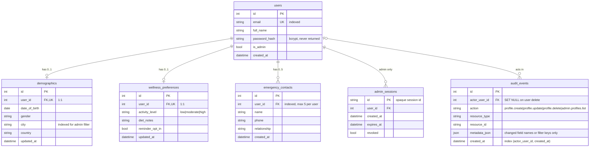

# Week 2: Schema diagram

All data is fictional. Every profile row is owned by exactly one user through `user_id`
(FK to `users.id`, `ON DELETE CASCADE`). The API derives `user_id` from the JWT, never from the request body.

Design choices:
- Demographic and wellness are 1:1 (unique `user_id`) with `PUT` upsert: one current version per user.
- Emergency contacts are 1:N, capped at 5 per user in the API (409 beyond that), enforced atomically with a SQLite `BEGIN IMMEDIATE` reservation. Phones are stored canonical (`+` optional, then 7 to 15 digits) and unique per user.
- Audit metadata stores which fields changed or which filters were used, never values,
  passwords, or tokens, so the audit log does not become a second copy of profile data.
