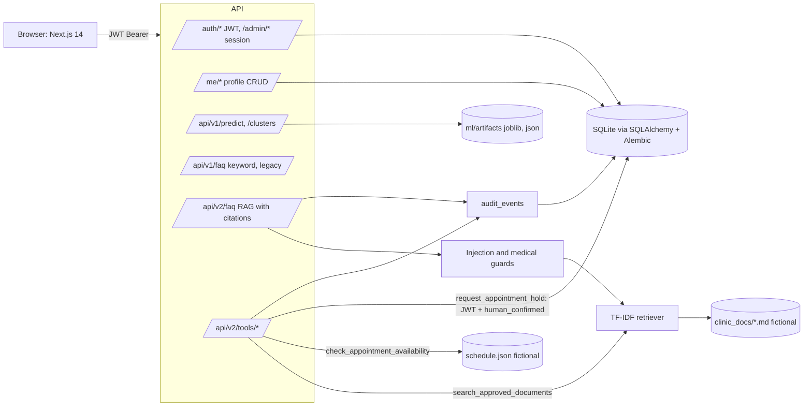
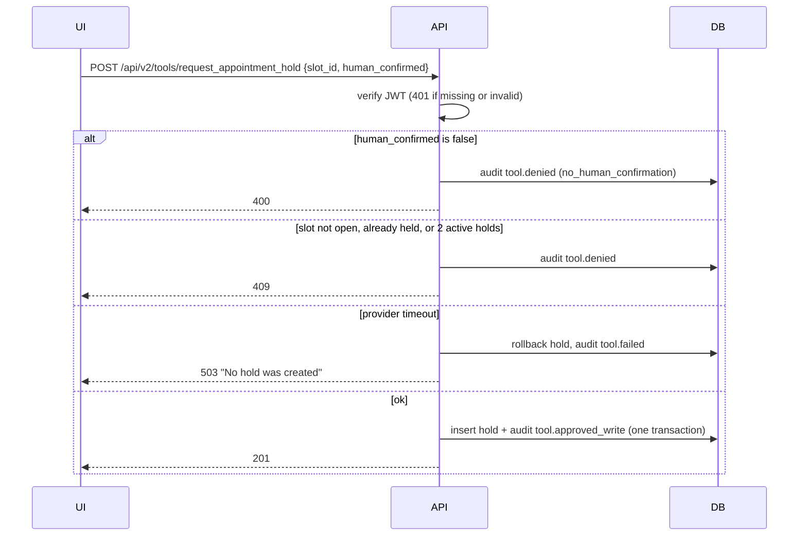

# Week 4 architecture

## Request flow for a write tool

## Logging

Every RAG answer and tool call writes an `audit_events` row with `resource_type="tool"` and action `rag.answer`, `tool.call`, `tool.denied`, `tool.approved_write` or `tool.failed`. Metadata holds retrieval refs (chunk ids), setting, abstain reason, counts and error class names. It never holds question text, tokens or passwords (`app/audit.py` also strips forbidden keys).

## Migration note

`POST /api/v1/faq` (Week 3 keyword FAQ) is kept unchanged so Week 3 clients and tests keep working. New clients use `POST /api/v2/faq`, which returns `citations` (doc_id, title, chunk_id, score) and `reason` on abstain. The Week 4 UI page `/assistant` uses v2.
